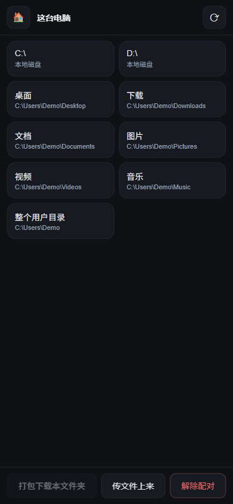
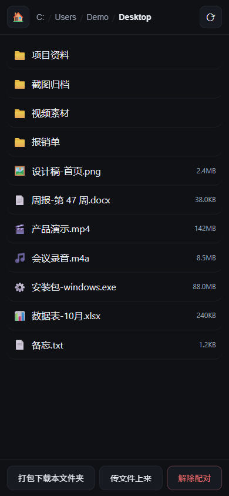
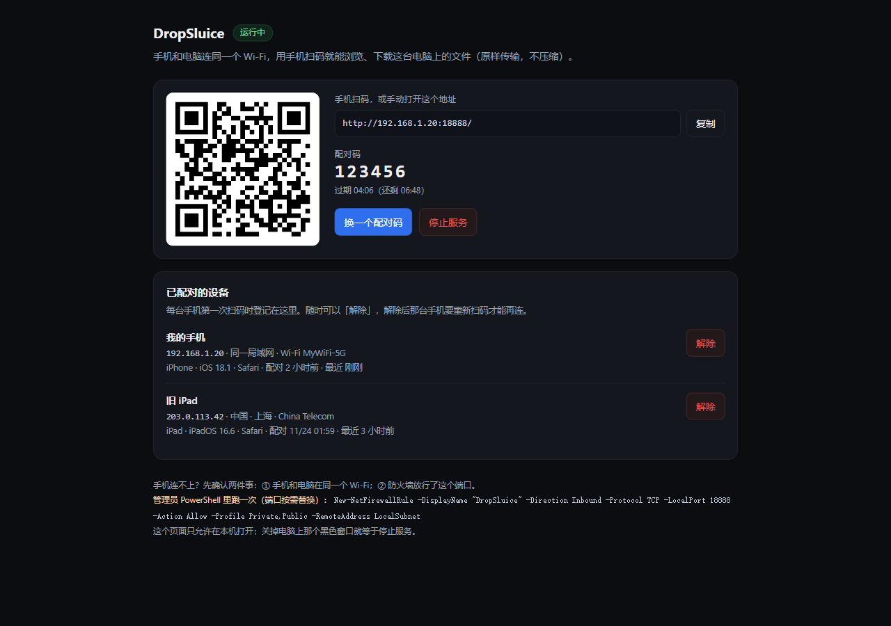
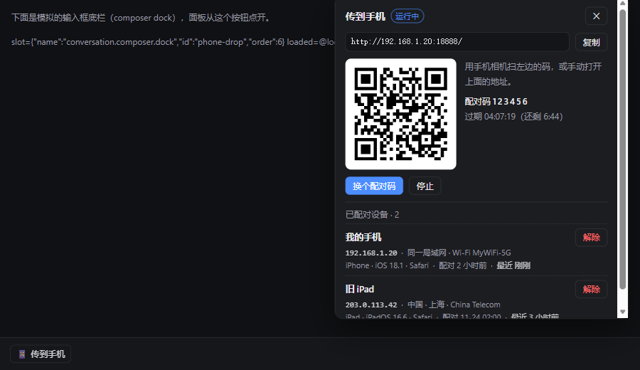

# Byteferry · 手机取件

在自己电脑上开一个小服务，手机连同一个 Wi-Fi，扫一次二维码，就能：

- 浏览这台电脑的**整块磁盘**（C:、D:、桌面、下载、文档、图片、视频…）
- **原样下载**文件：不转码、不重新压缩，下载完的 SHA256 和电脑上那个文件一模一样
- 把整个文件夹**打包成一个 zip** 下载（store 模式，只打包不压缩，解开还是原文件）
- 反过来，把手机里的照片/文件**传回去**

电脑那一端有两种用法：装成 DeepSeek Harness 的插件（网页输入框上方出现「📱 传到手机」按钮），或者直接跑一个命令行服务 / 一个 exe。三种形态是同一份代码。

- 运行**零第三方依赖**：只用 Node 内置模块（连 zip 和二维码都是自己写的）
- 手机端**不用装 App**：浏览器打开就是页面（想更像 App 的话，仓库里也有 APK 源码）
- 网络只走**同一个局域网**：服务监听 `0.0.0.0:18888`，但配对这一步只在电脑本机能开，手机必须拿着 6 位码换令牌

---

## 0. 先看这里：它凭什么说「没有压缩」

很多传输工具会「顺手」把照片转一遍格式、把视频转一遍码率，或者把 zip 重新压一遍。Byteferry 的做法是：

1. 下载走 HTTP 原始字节流，带 `Content-Length`，并明确告诉浏览器 `Cache-Control: no-store, no-transform`（别缓存、别改写），响应里**没有** `Content-Encoding`。
2. 文件夹打包用 **store 模式 zip**：只写目录信息，不压缩内容。zip 里每个文件的字节和磁盘上的字节完全相同。
3. 校验不是嘴上说：自测脚本会下载一个 4.5 MB 的伪随机文件、算 SHA256 和源文件比；再把 zip 用 Windows 自带的 `Expand-Archive` 解开，逐字节比对。

三件事都在本机实测过（见 §7「已验证 / 未验证」）。

### 长什么样

手机端（左：开场选盘符和常用目录；右：进到某个文件夹，文件带大小，点一下就下载）：

| 手机 · 选盘符 | 手机 · 浏览文件夹 |
| --- | --- |
|  |  |

电脑端（左：打包版 exe 的面板；右：DSH 输入框上方的浮层，小窗口下内部滚动）：

| 打包版面板 `/desktop` | DSH 里的浮层 |
| --- | --- |
|  |  |

> 截图里的 IP、Wi-Fi 名、设备型号、文件名**全是演示数据**：由 `verify/phone-harness/`、`verify/panel-harness/` 两个假服务器用 `public/` 里真正的页面和真正的 `client.js` 渲染出来。真实截图会带出本人用户名和私人文件名，所以没有放进仓库。

---

## 1. 三种用法，挑一个

### 用法 A：做成 DSH 插件（最省事）

前提：你用的是 DeepSeek Harness 桌面版，profile 里能装 bundle。

```
# 在 DSH 里（让 agent 做）：
#   plugin_manager  action=install_bundle  target=<这个目录的绝对路径>
```

装好后，对话框输入区上方会多一个「📱 传到手机」按钮。点它：二维码、配对码、当前已配对的设备、解除按钮都在浮层里。

不想用命令行装也行：DSH 的 Plugins 页面 → Add plugin → 选这个目录。

### 用法 B：直接跟 agent 说

「把 D 盘那个 3.2G 的视频传到手机上」「手机现在能看到什么」「把那个陌生设备踢掉」——插件给 agent 提供了 `phone_drop` 工具（action = `start` / `status` / `pair` / `devices` / `revoke` / `stop`）。

### 用法 C：命令行独立跑（不用 DSH 也行）

```bash
node server.mjs                 # 默认 18888，自动开配对窗口，终端里直接把二维码画出来
node server.mjs --port 18900    # 换端口
node server.mjs --pair          # 服务已经在跑时，再要一个新配对码（不重启）
```

跑起来后终端会打印：本机所有局域网地址、配对码、以及用半块字符画的二维码。运行中还接受按键：`p` 换码、`d` 看已配对设备、`q` 退出。

也可以直接用打好的 `Byteferry.exe`（见 §6.1）：双击 → 自动开浏览器面板。

> 第一次跑之前，Windows 防火墙要放行这个端口（见 §3 第 2 步）。终端和面板里都会把这行命令原样打出来，复制即可。

---

## 2. 手机那边怎么操作

1. 手机连**同一个 Wi-Fi**（和电脑同一个路由器；电脑插网线也行，只要在同一个网段）。
2. 打开手机相机/微信扫一扫，扫电脑上的二维码。或者手动打开 `http://<电脑的局域网IP>:18888/`。
3. 第一次会让你输 6 位配对码（网页会自动带上，一般直接按「配对」）。
4. 之后随便逛：点盘符 → 进文件夹 → 点文件就下载（走浏览器/系统的下载，原样保存）。
5. 底栏三个按钮：「打包下载本文件夹」（当前目录打成一个 zip）、「传文件上来」（把手机里的文件传回当前目录）、「解除配对」。

配对令牌存在手机浏览器的 Cookie 里（`pd_session`，HttpOnly、SameSite=Lax、一年有效）。换手机/换浏览器要重新扫一次码。

---

## 2.5 电脑上怎么管这些手机（谁连进来了、怎么踢掉）

面板里的每台设备占三行：

```
我的手机                                     [解除]
192.168.1.20 · 同一局域网 · Wi-Fi MyWiFi-5G
iPhone · iOS 18.1 · Safari · 配对 2 小时前 · 最近 刚刚
```

- **第一行**：配对时填/猜出来的名字（手机会话里可以改）。右边「解除」立刻让这台手机的令牌失效，它下次请求就是 401，必须重新扫码。
- **第二行**：它的 IP（最后一次见到的），加「它是从哪儿来的」：
  - 局域网设备 → `同一局域网 · Wi-Fi <名字>`（Wi-Fi 名是从 `netsh wlan show interfaces` 拿的，只在电脑连着 Wi-Fi 时有）。
  - 公网设备 → `城市 · 运营商`，查 `ip-api.com`（失败换 `ipwho.is`），结果缓存 24 小时。
- **第三行**：设备型号/系统/浏览器（从 User-Agent 认出来的）、配对时间和最近活跃时间。

**为什么局域网设备没有城市？** 手机连的是你家路由器，它看到的地址是 `192.168.x.x` 这种内网地址，任何 IP 库都不会给内网地址标注城市——那不是"没查到"，是根本没有这个信息。所以局域网设备只显示「同一局域网 + Wi-Fi 名」。

**为什么不做手机 GPS 定位？** 因为局域网 http 页面在手机浏览器里被禁止申请定位权限（必须 HTTPS + 证书）。要做到"显示手机真实位置"就得给这个服务装 HTTPS 证书并在手机上信任它，成本和麻烦都不值当，所以不做。

**隐私提醒**：一旦有**公网 IP** 连进来（比如你做了端口映射），为了显示城市名，这个公网 IP 会被发给 `ip-api.com` / `ipwho.is`。局域网里用不会发生这件事。不想要这个功能可以把 `lib/geo.mjs` 的调用去掉（面板就只显示 IP）。

---

## 3. 手机打不开？按这个顺序查

1. **确认在同一个网段**：电脑上 `ipconfig` 看 WLAN 的 IPv4（`192.168.x.x` / `10.x.x.x`），手机 Wi-Fi 详情里看自己的 IP，前三段应该一样。手机用流量打不开是正常的——这个服务只在局域网里。
2. **放行防火墙**（Windows 第一次必须手动，尤其是 Wi-Fi 被识别成"公用网络"时）：

   ```powershell
   # 管理员 PowerShell 跑一次；端口换了就把 18888 换掉
   New-NetFirewallRule -DisplayName "Byteferry" -Direction Inbound -Protocol TCP `
     -LocalPort 18888 -Action Allow -Profile Private,Public -RemoteAddress LocalSubnet
   ```

   删掉这条规则：`Remove-NetFirewallRule -DisplayName "Byteferry"`
3. **看电脑上服务是不是真在跑**：面板顶部有「运行中」；或者命令行窗口还开着。
4. **端口被别的程序占了**：面板/终端会提示。命令行用 `--port 18900` 换一个，exe 会自动往后试 9 个端口。

还是不行，就在电脑上用 `curl http://127.0.0.1:18888/api/me` 试——本机能通说明服务没问题，问题在网络上。

---

## 4. 安全说明（请读完再决定要不要开）

- **配对必须发生在电脑本机**：二维码接口 `/qr.svg`、配对窗口 `/api/pairing` 只对回环地址（`127.0.0.1`/`localhost`）开放，局域网里的其他机器访问会拿到 403/404。所以别人即使连上你的 Wi-Fi，也开不出自己的配对码。
- **6 位配对码 + 一次性窗口**：窗口默认开 10 分钟，配对成功立刻作废并关闭。错码有速率限制（每 IP 5 分钟内错 5 次就 429），防暴力猜。
- **令牌只存哈希**：手机上拿到的是一串随机令牌，电脑这边 `.data/state.json` 只存它的 SHA256。文件泄漏了也不能拿来冒充手机（除非连哈希一起被拖走——那就该"解除"全部设备了）。
- **随时随地能踢人**：面板/工具里每台设备都有「解除」，立刻生效。
- **没有加密传输**：局域网内是 http。同一 Wi-Fi 下懂行的人可以用 ARP 欺骗之类的手段看流量。家里/自己热点没问题，公共 Wi-Fi 别开。
- **不暴露到公网**：这个服务没有做反向代理/端口映射的安全加固，别直接映射到公网。真要从外网用，套一层 VPN（WireGuard/Tailscale 之类）比暴露端口安全得多。
- **它能读整块磁盘**：这是设计目标（你要的就是"随意调用电脑文件"），但也意味着**拿到令牌的那台手机能读你所有盘**。别把二维码给别人扫，别把令牌抄给别的设备。

---

## 5. 自测怎么跑（想确认「真的没压缩」）

```bash
node verify/e2e.mjs          # 端到端 23 项：配对、列目录、下载 SHA256、Range 续传、zip、上传、解除
node verify/device-info.mjs  # 设备信息 30 项：UA 解析、内网判定、IP/网卡/Wi-Fi/型号、归属地
node verify/terminal-qr.mjs  # 终端二维码 5 项（矩阵 → 半块字符 → 反推矩阵逐格一致）
node verify/exe-e2e.mjs      # 打包版 exe 18 项（需要先构建，见 §6.1）
```

`e2e.mjs` 不传 `--base-url` 时会**自己起一个一次性服务**（随机端口 19100+、数据目录在临时目录），不会碰你正在用的 `.data`。

二维码编码器的交叉验证（可选，需要 Python）：

```bash
python -m pip install qrcode segno zxing-cpp pillow
node verify/all.mjs && python verify/all.py    # 128 个矩阵与 python-qrcode 逐格比对（写到当前目录的 qr-all.json）
python verify/decode-panel-qr.py               # 把面板上的二维码 SVG 栅格化，用 zxing 读回 URL
```

---

## 6. 做成「安装包」和「APK」（双端部署）

### 6.1 电脑端：三个产物，从轻到重

| 产物 | 大小 | 怎么用 | 适合谁 |
| --- | --- | --- | --- |
| `dist/Byteferry-1.0.1-portable.zip` | ~33 MB | 解压，双击 `一键开始.bat` | 想立刻用、不想装东西 |
| `dist/Byteferry.exe` | ~90 MB | 直接双击（单文件，自带 Node） | 自己放个地方跑 |
| `dist/Byteferry-Setup-1.0.1.exe` | ~24 MB | 安装向导 → 开始菜单 | 想「像正常软件那样装上」 |

exe 是**单文件**：Node 官方 SEA（Single Executable Application）把 `outfile + node.exe` 缝在一起，`public/`、`desktop/` 里的 6 个文件作为 assets 内嵌，双击即用，目标机器**不需要装 Node**。

构建（Windows）：

```powershell
cd <repo>
npm --prefix build/tools install            # esbuild + postject + rcedit（一次性）
node scripts/build-desktop.mjs              # → dist/Byteferry.exe
node verify/exe-e2e.mjs --exe dist\Byteferry.exe --port 18903
```

打包顺序有一个坑，记在这里免得再踩：**rcedit（写图标/版本）必须在 postject（注入 SEA blob）之前**。先注入 90 MB 的 blob 再让 rcedit 改资源，rcedit 会直接挂死（等几分钟也不返回）；对没注入的 node.exe 改资源只要 0.1 秒。而且直接调 `build/tools/node_modules/rcedit/bin/rcedit-x64.exe`，别走 npm 那层的跨进程包装（在这台机器上也会挂）。

做安装包：

```powershell
# ① 装 Inno Setup（会装到 %LOCALAPPDATA%\Programs\Inno Setup 6，用户级，不需要管理员）
winget install --id JRSoftware.InnoSetup --accept-source-agreements --accept-package-agreements

# ② 抓简体中文语言包到 build\tools\ChineseSimplified.isl（Inno 自带 Languages\ 里没有中文）
node scripts/fetch-inno-chinese.mjs

# ③ 编译：产物是 dist\Byteferry-Setup-1.0.1.exe
"C:\Users\<你>\AppData\Local\Programs\Inno Setup 6\ISCC.exe" installer\byteferry.iss
```

安装包做成**多模式**：向导里能选「只为我安装」（装进 `%LOCALAPPDATA%\Programs`，不需要管理员）或「为所有用户安装」（弹 UAC，装进 `Program Files`，并可选自动加防火墙规则）。选后者时带一个可勾选项「放行 Windows 防火墙的 18888 端口」。

### 6.1.5 双击 exe「窗口一闪就没」怎么修的（1.0 的一次真 bug）

1.0 版双击后会闪一下就消失。两个原因叠在一起：

1. **数据目录建不出来**：exe 默认把配对记录写到 `%LOCALAPPDATA%\Byteferry`，在那台机器上这个 `mkdir` 返回 `EPERM`，进程刚起来就带着堆栈退出。
   → 改成**逐级试写**：`%LOCALAPPDATA%\Byteferry` → exe 旁边的 `.data` → 系统临时目录，第一个真能写的胜出（打印在窗口里）。
2. **端口被占就 1.2 秒退出**：18888 被已经跑着的实例占住时，旧版打印完提示就 `exit`。
   → 改成：占着端口的是 Byteferry 就打开它的面板并**停在窗口等你按回车**；是别的程序就自动往后试 9 个端口。

现在**所有退出路径都会等一次回车**（判据 `process.stdin.isTTY`，所以脚本调用不会卡住；`BYTEFERRY_NO_PAUSE=1` 可跳过），错误不再一闪而过。

复验：

```powershell
# 模拟真双击（拿到真控制台）
cmd /c start "" "$PWD\dist\Byteferry.exe" --no-open
Get-Process Byteferry        # 5 秒后还在 = 窗口没被关掉
node verify/exe-e2e.mjs --exe dist\Byteferry.exe --port 18903   # 18 项
```

### 6.2 手机端：APK

`android/` 是一个**迷你外壳**，不是把页面重做一遍：

- 启动页：一个大按钮「扫电脑上的二维码」+ 一个手动输入地址的框（地址会记住）
- 扫码页：CameraX 预览 + zxing 解码（只认 QR，`TRY_HARDER`），**不依赖 Google Play 服务**
- 主界面：一个 WebView 直接打开电脑那个页面；下载交给系统 `DownloadManager`（带 Cookie 和 UA，存到"下载"目录）；上传走系统的文件选择器
- 按下返回键：能回退就回退，退到底弹一个菜单（重新扫码 / 手动地址 / 清除配对 / 退出）

构建（Windows，需要 JDK 17+ 和 Android SDK）：

```powershell
$env:JAVA_HOME='C:\Program Files\Eclipse Adoptium\jdk-21.0.9.10-hotspot'
$env:GRADLE_USER_HOME='<repo>\build\gradle-home'
cd android
..\build\gradle-8.9\bin\gradle.bat :app:assembleRelease --no-daemon --console=plain
# 产物：android\app\build\outputs\apk\release\app-release.apk
```

第一次构建会踩 `checkDebugDuplicateClasses`（CameraX 拖进老的 `kotlin-stdlib-jdk7/jdk8`），仓库里的 `android/app/build.gradle` 已经用 `exclude` + `constraints` 修掉了。

**签名**：release 用 `android/keystore.properties` 指向的 keystore 签名，这个文件和 keystore 本身都**没有进仓库**（`.gitignore` 里有）。你要自己出包，就自己生成一个：

```powershell
keytool -genkeypair -keystore build/byteferry-release.jks -alias byteferry `
  -keyalg RSA -keysize 2048 -validity 10950 -storepass <你的口令> -dname "CN=Byteferry"
```

装 APK 时注意两点：安卓会拦「未知来源」，要允许一次；首次打开要给**相机**权限（手动输地址不需要）。

### 6.3 双端怎么配合起来用

1. 电脑跑起来（插件按钮 / `node server.mjs` / 双击 exe），面板上出现二维码。
2. 手机装 APK，打开，点「扫电脑上的二维码」，对着屏幕扫。
3. 网页自动带上 6 位码完成配对，直接进文件列表。
4. 以后每次打开 APK 都直接进（地址记住了）；电脑那边能随时「解除」。
5. 想传回去：手机页面底栏「传文件上来」，选照片/文件，落到电脑当前目录。

---

## 7. 已验证 / 未验证（诚实清单）

**已验证（都有脚本或命令可复跑）：**

- 二维码编码器：16 段测试串 × 8 种掩码 = **128 个矩阵与 python-qrcode 逐格完全一致**；zxing 能把每种掩码都解码回原文；终端半块字符版 5 项回归全过。
- 服务端 e2e **23 项**：未配对 302/401、6 位码配对（中文设备名）、配对码一次性作废、Bearer 头、列盘符与常用目录、相对路径被拒、4.5 MB 文件下载 **SHA256 与源文件一致**、`Content-Length`/`Accept-Ranges`/`no-store`/无 `Content-Encoding`/`filename*=UTF-8''`、HEAD 长度一致、**Range 4 段拼接逐字节等于原文件**、**zip（子目录+中文名+空文件+二进制）用 Expand-Archive 解开逐字节一致**、上传字节一致且重名自动改名不覆盖、解除后旧令牌 401。
- 设备信息 **30 项**：UA→「iPhone · iOS 18.1 · Safari」、公网/内网判定（`172.16` 内网但 `172.32` 公网）、IP/网卡/Wi-Fi 名落库、`1.1.1.1` 真查到「澳大利亞 · Queensland · South Brisbane · Cloudflare」且第二次走缓存。
- 打包版 exe **18 项**：面板 200、二维码 SVG、配对、下载 SHA256、**伪造 Host → 403 / 本机 Host → 200**（只允许本机）、解除后 401。
- 绿色包：解压后对解压出来的 exe 跑同一套 18 项，全过；`cmd /c start` 双击模拟 5 秒后进程仍存活。
- APK：`apksigner verify` 通过、`aapt2 dump badging` 的包名/版本/权限/SDK 都对。
- 插件形态：`plugin_manager` 安装返回 `applied`；`phone_drop` 工具能 start/status/pair/devices/revoke/stop；dock 槽位里能看到 `{id:'phone-drop', order:6}` 的注册。

**未验证（不做任何保证）：**

- **安装包（`Byteferry-Setup-1.0.1.exe`）的安装过程没能在本机跑通**：编译成功、Inno 的编译期校验也过，但在这台机器上，安装进程往 `C:\Program Files`、`%LOCALAPPDATA%\Programs`、`HKCU\...\Uninstall` 写东西时一律 `错误 5: 拒绝访问`——连一个只有三行的最小 Inno 脚本也一样失败。这是**本机环境**的限制（DSH 起的进程都是提权进程，Inno 为此会切到一个受限令牌），不是脚本写错。所以「双击 → 装进 Program Files → 开始菜单 → 卸载」这条链路**请你亲手试一次**；如果它报错，直接用绿色包，功能完全一样，只是不写注册表、不建开始菜单。
- **APK 没在真手机上装过**：只验证了产物、签名、manifest，没有真的装到手机、没有用手机相机扫过电脑屏幕。相机预览、CameraX 在这个机型上的表现、`DownloadManager` 的保存路径，都还要一次真机确认。
- **真机扫码（网页版）**：写这份文档的机器上没有可用的手机取件环境，所有"手机端"结论来自 HTTP 层自测（同一套 API、同一套 cookie 逻辑），没有经过真手机浏览器。
- **面板在真 DSH 窗口里的渲染**：DSH 网页有启动令牌，非本人浏览器打不开，所以面板长相是用 `verify/panel-harness/`（真实 `client.js` + 真 react + 假数据）截图核对的，**没有在真 DSH 页面里点开过**。打包版自己的面板（`/desktop`）是同一个 HTML，截图用的是 `verify/phone-harness/` 的假数据（见 §0 的说明）。
- **公网 IP 归属地的线上表现**：离线脚本里查过 `1.1.1.1`，面板截图里那台"公网设备"是假数据（`203.0.113.42` 是文档专用地址），没有真的从外网连进来过。
- **双击闪退的根因只在一台机器上复现过**：`%LOCALAPPDATA%\Byteferry` 被拒、端口被占这两种情况都实测到并修好了；如果还有别的原因（比如杀毒软件拦 SEA exe）仍可能闪退——所以加了"任何退出路径都等一次回车"，让错误有机会留在屏幕上。

---

## 8. 目录结构

```
phone-drop/
  index.js            DSH 插件 Host 半：起服务、面板接口、phone_drop 工具
  client.js           DSH 插件 Client 半：dock 里的「传到手机」按钮 + 二维码浮层
  cordis.patch.yml    插件补丁（把 @local/phone-drop 插进插件树）
  package.json        bundle + client 声明、exports、locale/icon
  server.mjs          命令行入口（--port / --host / --pair / --open）
  lib/
    app.mjs           HTTP 路由与全部接口
    state.mjs         配对窗口 + 设备令牌（持久化到 .data/state.json，只存哈希）+ 设备的 IP/UA
    net.mjs           局域网地址挑选、回环判断、内网地址判定、网卡名、Wi-Fi 名
    ua.mjs            从 User-Agent 读「iPhone · iOS 18.1 · Safari」这类设备描述
    geo.mjs           公网 IP → 城市（ip-api.com，失败换 ipwho.is，缓存 24 小时）
    files.mjs         盘符 / 常用目录 / 列目录（跳过隐藏和系统目录）
    root.mjs          「程序自己在哪」「数据目录放哪」（exe 里没有 import.meta.url，且要逐级试写）
    zip.mjs           流式 store 模式 zip（不压缩、边读边发、不落临时文件）
    qr.mjs            自写二维码编码器（Byte 模式、纠错 M、v1–v10、8 掩码）
    terminal-qr.mjs   终端里用半块字符画二维码
  public/             手机端页面（原生 JS，深色 UI，401 自动跳配对）
  verify/             全部自测脚本
    panel-harness/    只用于截图核对 dock 浮层的假服务器（真 client.js + 假 /phone-drop/state）
    phone-harness/    只用于截图手机端页面的假服务器（真 public/*，假 /api 数据）
    shots/            验收截图（全部是演示数据）
  docs/DETAIL.md      插件详情页（架构、接口表、实现要点）
  desktop/
    main.mjs          打包版 exe 的入口（SEA：内嵌静态资源、打印二维码、开面板）
    desktop.html      打包版自己的本机面板（轮询 /api/admin/state）
    一键开始.bat       绿色版启动器（设 BYTEFERRY_NO_PAUSE=1，退出后自己 pause）
    使用说明.txt       装完给最终用户看的三步上手
  scripts/
    build-desktop.mjs 打 exe：esbuild → SEA blob → rcedit 图标 → postject 注入
    make-icon.py      画图标（Pillow，多尺寸 .ico）
    fetch-inno-chinese.mjs  下载 Inno Setup 的简体中文语言包
  installer/byteferry.iss   Inno Setup 脚本（多模式安装 + 可选防火墙任务）
  android/            手机端 APK 工程（WebView 外壳 + CameraX 扫码）
  dist/               构建产物（gitignore）
  build/              构建期下载的东西（SDK、Gradle、keystore、tools、日志）——不提交
```

**运行环境**：Node 18+（用到 `fetch`、`AbortSignal.timeout`）。打 exe 需要 Node 22+（SEA）。
**只有构建期**才需要：`esbuild` / `postject` / `rcedit`（打 exe）、Inno Setup（做安装包）、JDK 17+ / Android SDK / Gradle 8.9（做 APK）。这些都不在运行时依赖里。

---

## 9. 许可

MIT，见 [LICENSE](LICENSE)。
